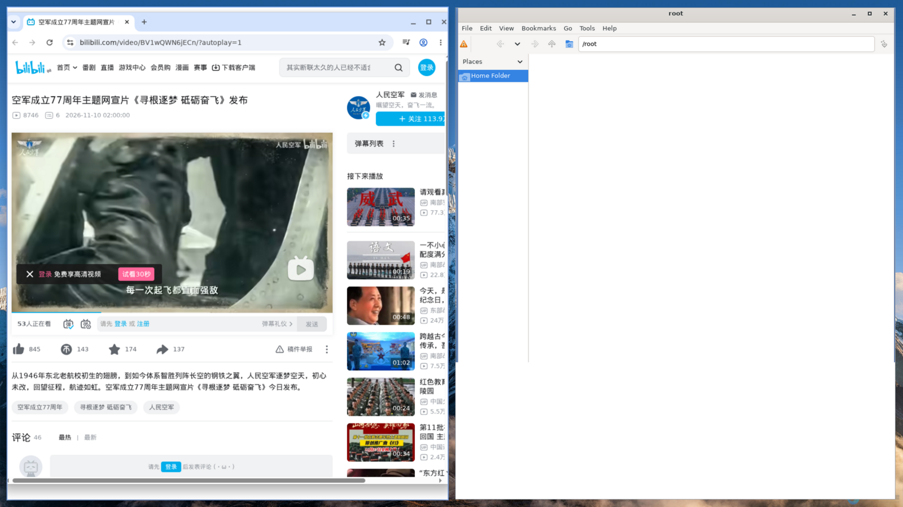
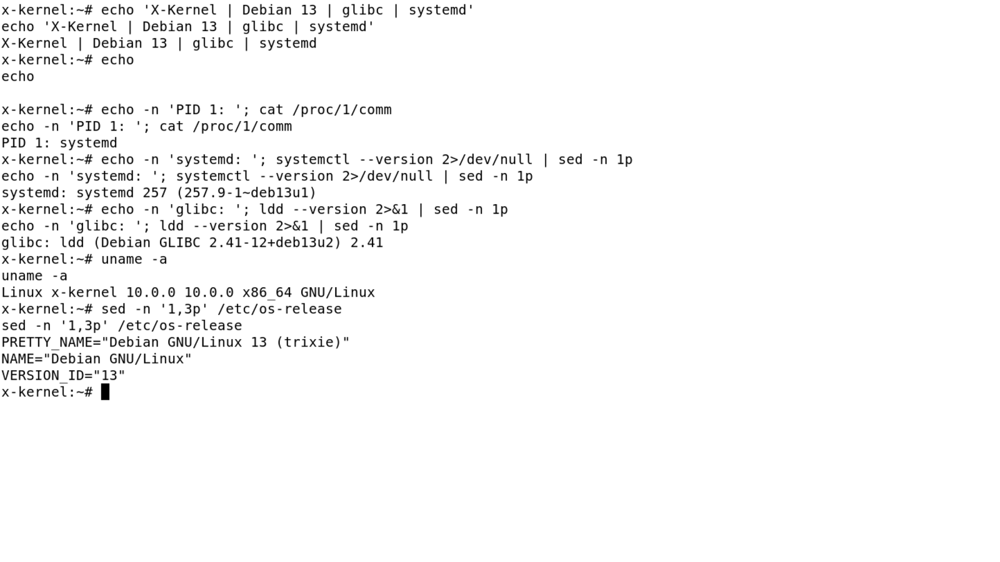

# X-Kernel

[English](README.md) · [代码仓库](https://gitee.com/openkylin/x-kernel) · [Issues](https://gitee.com/openkylin/x-kernel/issues) · [社区](https://x-kernel.zulipchat.com)

[](LICENSE)

<!-- TODO(badge): 有公开 CI/release URL 后补充 badge。 -->

X-Kernel 是一个使用 Rust 编写、面向 Linux ABI 的单体内核。它可以在 x86_64、AArch64、RISC-V 64 和 LoongArch64 上运行基于 musl/glibc 构建的 Linux 用户态程序，在内核内为机密计算 guest 提供 TEE 支持，并可运行 Chromium、niri、Xorg/Xwayland 等 Wayland/X11 桌面负载。

<p align="center">
  
</p>
<p align="center"><em>X-Kernel 上的 niri + Chromium（哔哩哔哩）+ PCManFM（x86_64，virtio-gpu，1600x900）。</em></p>

各子系统按明确的职责与所有权边界拆分为 crate，详见[源码布局](#源码布局)。项目当前在 `main` 分支活跃开发（`0.3.0-dev`），按季度发布里程碑版本，见[发布规范](docs/release.md)。

**数据基线：** 能力与 CI 数据最后核对于 2026-11-12。性能、syscall 覆盖和 workload 表中标记为 `TBD` 的数据是下一次测量前的占位符。

## 目录

- [为什么选择 X-Kernel](#为什么选择-x-kernel)
- [快速开始](#快速开始)
- [真实负载](#真实负载)
- [平台支持](#平台支持)
- [能力状态](#能力状态)
- [桌面负载](#桌面负载)
- [设计](#设计)
- [验证](#验证)
- [性能](#性能)
- [配置](#配置)
- [源码布局](#源码布局)
- [文档](#文档)
- [社区与贡献](#社区与贡献)
- [安全](#安全)
- [已知限制](#已知限制)
- [路线图](#路线图)
- [许可证](#许可证)
- [致谢](#致谢)

## 为什么选择 X-Kernel

- **Linux ABI，面向生产用户态。** X-Kernel 在 `core/ksyscall`、`posix/` 和 `api/linux_sysno` 中实现 Linux 兼容的系统调用与 POSIX 接口。systemd 以 PID 1 启动并运行 glibc 用户态，Docker hello-world 可运行，Wayland/X11 桌面也可运行在同一内核上；Starry Test Harness 从用户态验证这套 ABI。
- **四种架构，三种进入 CI。** x86_64、AArch64、RISC-V 64、LoongArch64 均受支持；x86_64、AArch64、RISC-V 进入 PR 流水线（构建、单测、运行时测试，x86_64/AArch64 另有 TEE 测试）。LoongArch64、CSV、pKVM、RK3588 目前有文档和手动路径，但尚未进入 PR CI。
- **内核内的机密计算。** 海光 CSV 支持硬件根密钥（HUK）和 attestation（远程证明）；ARM virtCCA 支持 HUK 派生；pKVM 是实验性的 guest 模式。TEE 支持 TA（可信应用）生命周期、安全存储，以及基于 RustCrypto 的 SM2/ECC/RSA。
- **桌面级图形能力。** DRM/KMS、virtio-gpu 2D/3D、EDID、page-flip/vblank、fbdev 与 virtio-input 支持 Chromium（Wayland）、niri、Xorg/Xwayland，包含键盘/鼠标输入和宿主窗口 resize。合成器与 rootfs 属于用户态产物；内核提供显示、GPU 和输入接口。
- **成体系的验证。** 代码树内有 4,731 个 `#[def_test]` 和 1,165 个 `#[test]` 用例；外部 [Starry Test Harness](https://gitee.com/openkylin/starry-test-harness) 在 `ci` 和 `ci-test-iter` 中提供 51 个 guest 用例。带日期的公开通过率报告尚未发布，详见[验证](#验证)和[已知限制](#已知限制)。

## 快速开始

### 前置条件

| 依赖 | 说明 |
|---|---|
| Rust | 由 `rust-toolchain.toml` 固定（1.95.0，含 5 个 target），无需手动执行 `rustup target add`。 |
| QEMU | `make run` 需要对应架构的 QEMU system emulator。 |
| `cargo-binutils`、`rust-objcopy` | 生成内核镜像所需。 |
| Musl 交叉工具链 | 仅用于 uapps、TEE 测试和 Harness guest 用例；内核本身不编译 C，见[交叉工具链](#交叉工具链)。 |
| rootfs 工具 | `make rootfs` 需要 `curl` 和 `xz`。 |
| x86_64 启动介质 | UEFI 需要 OVMF/EDK2，FAT 介质需要 `mkfs.fat` 和 mtools，LinuxBoot setup 代码需要 GNU i386 工具链。 |
| 单测覆盖率 | `debugfs`、`rust-profdata`、`rust-cov`。 |
| 仓库检查工具 | `make install-tools` 安装固定版本的 `cargo-shear`、`licensure` 和 dylint 工具。 |

CI builder 镜像提供 CI 构建环境（项目工具链由 CI 安装），见 [`scripts/ci/docker/`](scripts/ci/docker/) 和 [`docs/jenkins-pipeline.md`](docs/jenkins-pipeline.md)。完整前置条件参考 [`docs/ai/skills/build-workflow/SKILL.md`](docs/ai/skills/build-workflow/SKILL.md)。

### 构建与运行

```bash
# AArch64 QEMU：最短路径
cp platforms/kplat-aarch64/qemu_defconfig .config
make defconfig
make rootfs          # 需要 curl 和 xz
make build
make run
```

```bash
# x86_64 QEMU，可选 UEFI 启动
cp platforms/kplat-x86_64/qemu_defconfig .config
make defconfig
make run
make run UEFI=y
```

x86_64 上 `make run` 默认使用 LinuxBoot，`make run UEFI=y` 选择 OVMF/UEFI。可通过 `OVMF_CODE` 和 `OVMF_VARS_TEMPLATE` 指定固件路径。

x86_64 CSV 使用 `scripts/start.sh` 构建 UEFI 镜像并以 SEV 启动 QEMU。脚本需要 OVMF，以及默认名为 `cvm_1_launch_blob.bin` 和 `cvm_1_guest_owner_dh.cert` 的 SEV 启动产物。

```bash
bash scripts/start.sh
```

### 真实负载

这些端到端负载用于区分 X-Kernel 与只实现系统调用表的 Linux ABI 内核。标记为 `TBD` 的行是下一次测量前的占位符。

| 负载 | 命令 | 预期结果 | 状态 |
|---|---|---|---|
| systemd + glibc | `make rootfs ROOTFS_VARIANT=debian-systemd` | systemd 257 + glibc 2.41 进入 shell | 已截图 2026-11-12 |
| Docker | `docker run --network=host --rm hello-world` | `Hello from Docker!` | `TBD` |
| Wayland 桌面 | `make run GRAPHIC=y DISK_IMG=<desktop-image>` | Chromium/niri/Xorg 启动 | 已截图 2026-11-12 |

<!-- TODO(data): 补充每个负载的内核 commit 和日志/CI 链接。 -->



*Debian 13 上的 systemd 257 + glibc 2.41（x86_64，`debian-systemd` rootfs）。*

### 运行参数

```bash
make run XKMAKE_ARGS='--memory 2g --smp 2 --no-net'
make run XKMAKE_ARGS='--no-vsock'
make run QEMU_ARGS='-d guest_errors'
make run QEMU_ARGS='-no-reboot'
```

`XKMAKE_ARGS` 透传给 xkmake；`QEMU_ARGS` 会原样追加在 `--` 之后，适合传递 QEMU 原生参数。`GRAPHIC=y` 会添加 GTK 显示窗口和 virtio 键盘/鼠标；配合桌面 rootfs 即可运行 Chromium、niri 或 Xorg/Xwayland，详见[桌面负载](#桌面负载)：

```bash
# 需要 Wayland/X11 桌面 rootfs
make run GRAPHIC=y GPU_XRES=1920 GPU_YRES=1080
```

默认的 `make rootfs` 是控制台镜像；桌面 rootfs 与合成器镜像独立于内核代码树分发，构建或启动内核本身不依赖它们。

### 单元测试与 PR 门禁

```bash
make unittest
make unittest UNITTEST_CRATE=kvfs,kprocess
make ci-test          # 拉取 Starry Test Harness 并运行 CI suite
```

在启用覆盖率（默认启用）时，单测成功运行后会在 `target/<rust-target>/<profile>/` 下生成 `coverage.txt`、`coverage.info` 和 `coverage.xml`。

### 交叉工具链

以下工具链仅用于 uapps、TEE 测试和 Harness guest 用例；内核本身不编译 C。

| 架构 | GCC | Musl | 下载 |
|---|---|---|---|
| x86_64 | 11.2.1 | git-b76f37f (2021-09-23) | [musl.cc](https://musl.cc/x86_64-linux-musl-cross.tgz) |
| aarch64 | 11.2.1 | git-b76f37f (2021-09-23) | [musl.cc](https://musl.cc/aarch64-linux-musl-cross.tgz) |
| riscv64 | 11.2.1 | git-b76f37f (2021-09-23) | [musl.cc](https://musl.cc/riscv64-linux-musl-cross.tgz) |
| loongarch64 | 13.2.0 | 1.2.5 | [LoongsonLab](https://github.com/LoongsonLab/oscomp-toolchains-for-oskernel/releases/download/loongarch64-linux-musl-cross-gcc-13.2.0/loongarch64-linux-musl-cross.tgz) |

## 平台支持

### 已支持目标

| 目标 | defconfig | CI 覆盖 | 状态 | 说明 |
|---|---|---|---|---|
| x86_64 QEMU | [`qemu_defconfig`](platforms/kplat-x86_64/qemu_defconfig) | 构建、单测、运行时、TEE、dylint | CI 验证 | 默认 x86_64 目标。 |
| x86_64 CSV | [`qemu_csv_defconfig`](platforms/kplat-x86_64/qemu_csv_defconfig) | 无 | 手动验证 | CSV HUK + attestation；[`scripts/start.sh`](scripts/start.sh)；需要 OVMF 和 SEV 产物。 |
| AArch64 QEMU | [`qemu_defconfig`](platforms/kplat-aarch64/qemu_defconfig) | 构建、单测、运行时、TEE、dylint | CI 验证 | 默认 AArch64 目标。 |
| RISC-V 64 QEMU | [`qemu_defconfig`](platforms/kplat-riscv64/qemu_defconfig) | 构建、单测、运行时 | CI 验证 | 无 TEE 测试。 |

### 实验性与路线图目标

| 目标 | defconfig | CI 覆盖 | 状态 | 说明 |
|---|---|---|---|---|
| AArch64 crosvm | [`qemu_crosvm_defconfig`](platforms/kplat-aarch64/qemu_crosvm_defconfig) | 构建检查 | 仅构建 | PR CI 不运行运行时。 |
| AArch64 virtCCA | [`qemu_virtcca_defconfig`](platforms/kplat-aarch64/qemu_virtcca_defconfig) | 构建检查 | 仅构建 | 只有 HUK 派生；代码树内没有 attestation 实现。 |
| AArch64 RK3588 | [`rk3588_defconfig`](platforms/kplat-aarch64/rk3588_defconfig) | 无 | 手动验证 | 最小 UART/GIC/timer/SMP 启动；VOP2 显示在特性分支，不在 `main`。 |
| LoongArch64 QEMU | [`qemu_defconfig`](platforms/kplat-loongarch64/qemu_defconfig) | 无 | 手动验证 | 运行时 CI 在路线图中。 |
| Kylin-x pKVM | 无 defconfig | 无 | 实验性 | 仅有 `kvm-guest-mem-share` / `kvm-mmio-guard` feature flag。 |

状态定义：

- **CI 验证**：PR 流水线中执行构建、启动、单测/运行时测试。
- **仅构建**：CI 中编译和 lint，不运行运行时。
- **手动验证**：有文档化的运行路径，但没有自动化 CI。
- **实验性**：feature flag 或特性分支上的工作，不是 `main` 的默认目标。

CI stage 定义见 [Jenkinsfile](Jenkinsfile)。<!-- TODO(data): 补充公开 CI 运行/状态链接。 -->

## 能力状态

状态：**已实现**表示已有测试或 workload 覆盖；**部分实现**表示已具备但只覆盖已知子集；**尚未**表示 `main` 中不可用。验证列标明证据来自 CI、单测还是手动验证。

| 领域 | 状态 | 验证 | 范围与已知缺口 | 代码 |
|---|---|---|---|---|
| 内存管理 | 已实现 | CI（单测） | 地址空间、缺页、COW、`mmap`/`brk`；Linux 语义子集。 | `mm/` |
| 进程与调度 | 已实现 | CI（单测 + Harness） | `fork`/`exec`、`wait*`、信号、futex、定时器、EEVDF 调度。 | `process/`, `task/` |
| VFS 与路径解析 | 已实现 | CI（单测 + Harness） | `namei`、mount 遍历、`openat2` `RESOLVE_*` 约束；Linux 子集。 | `fs/kvfs` |
| ext4 | 部分实现 | 单测 + Harness | 读写和 project quota；尚未完整通过 xfstests。 | `fs/filesystems/kext4` |
| 其他文件系统 | 部分实现 | 单测 | tmpfs/ramfs、procfs、sysfs、devfs/devpts、pipefs、9p、fat、cgroup2fs、bpffs；覆盖程度不一。 | `fs/filesystems/` |
| 网络 | 部分实现 | 单测 + Harness | TCP/IP、Unix socket、netfilter、vsock、netlink、TIPC；Linux 子集。 | `net/knet` |
| 驱动与设备模型 | 已实现 | 单测 + 构建 | 类型化驱动核心；virtio blk/net/gpu/input/console；PCI 与 IRQ 基础设施。 | `drivers/`, `io/` |
| 图形（内核） | 部分实现 | 单测 + 手动 | DRM/KMS、virtio-gpu 2D/3D、EDID、page-flip/vblank、fbdev；单 scanout virtio-gpu 路径。 | `io/drmdevice`, `io/fbdevice`, `io/inputdev` |
| 桌面负载 | 已实现 | 手动 | Chromium（Wayland）、niri、Xorg/Xwayland；键盘/鼠标输入与宿主窗口 resize。 | 用户态合成器 + `io/drmdevice`, `io/inputdev` |
| TEE | 已实现 | CI | TA（可信应用）生命周期、安全存储、基于 RustCrypto 的 SM2/ECC/RSA；CSV HUK + attestation；virtCCA HUK。 | `tee/`, [`docs/tee.md`](docs/tee.md) |
| 容器 guest | 部分实现 | 手动 | `docker run --network=host --rm hello-world` smoke；user namespace 与 cgroup 仍有缺口。 | `uapps/mini-oci`, [`docs/container-architecture.md`](docs/container-architecture.md) |

### 桌面负载

桌面路径使用内核的 DRM/KMS、virtio-gpu（2D/3D、EDID）和 virtio-input 驱动。已验证的用户态包括：

- **Chromium（Wayland）**：窗口、frame callback、键盘/鼠标输入。
- **niri**：基于 niri v26.04 构建的参考合成器磁盘；支持宿主窗口 resize 和指针/键盘输入。
- **Xorg/Xwayland**：通过 Xorg/Xwayland 路径运行 X11 负载。

合成器与桌面 rootfs 作为独立的用户态产物维护；内核的构建和启动不依赖它们。

<!-- TODO(data): 补充公开的桌面 rootfs/合成器镜像地址或生成它的 make target。 -->
> **桌面镜像来源：** `TBD` - 后续补充公开 URL 或 make target。

## 设计

X-Kernel 在运行时是单体内核，但在契约上按组件拆分。安全价值来自 API 隔离和可界定的审计范围，而不是 crate 之间的运行时隔离。

- **API 优先的所有权。** `mm/memspace`、`core/kuaccess`、`process/kexec`、`kirq`/`device_res` 是独立契约，不是某个 catch-all crate 的实现细节。200 多个 crate 共同定义所有权地图。
- **审计边界。** 每个 crate 在适用时提供 `docs/design.md` 和 `docs/security.md`；评审可以把改动限定在 API 契约及其下游使用者。
- **Unsafe 边界。** 每个 `unsafe` 块都需要 `SAFETY:` 说明；MMIO、DMA、上下文切换、TEE glue 等 unsafe 密集区域收在子系统 API 后面。
- **隔离边界。** crate 边界是编译期的，不是特权边界。TEE 为 TA/guest 提供运行时隔离；内核本身仍是单一地址空间。

```text
Linux 用户态：systemd / Docker / Wayland / X11
------------------------------------------------
ABI：ksyscall / posix / tee
------------------------------------------------
子系统：mm | process/task | fs | net | drivers/io
------------------------------------------------
架构 HAL：x86_64 | AArch64 | RISC-V 64 | LoongArch64
------------------------------------------------
平台：QEMU | crosvm | virtCCA | CSV | RK3588
```

## 验证

项目采用三层主要验证（内核单测、外部 [Starry Harness](https://gitee.com/openkylin/starry-test-harness) 回归和 TEE 测试），并辅以桌面和性能 workload。

| 层级 | 运行方式 | 规模 | CI 覆盖 |
|---|---|---|---|
| 内核单测 | `make unittest` | 4,731 个 `#[def_test]`；1,165 个 `#[test]`；122 个 `ut-tests` 目录 / 796 个文件 | x86_64、AArch64、RISC-V |
| PR 系统调用回归 | `make ci-test`（拉取 Starry Harness） | 40 个用例：38 guest + 1 boot + 1 powercut | x86_64、AArch64、RISC-V |
| 迭代 suite | Harness `make ci-test-iter run` | 14 个用例：13 guest + 1 powercut | 非 PR 门禁 |
| Debian APT suite | Harness `make ci-debian run` | 1 个 APT guest 用例 | 非 PR 门禁 |
| TEE 测试 | Jenkins `TEE Tests` | `tee_apps/` 中的安全存储与加密回归 | x86_64、AArch64 |
| 桌面负载 | `make run GRAPHIC=y` + 桌面 rootfs | Chromium（Wayland）、niri、Xorg/Xwayland | 手动；非 PR CI |
| 性能与长稳 | Harness `daily-test` / `longevity-test` | 37 个 daily 用例；9 个 longevity 用例；结果见[性能](#性能) | 外部 Jenkins job |

说明：

- 计数来自 Harness 提交 `2dcb0616`（2026-10-26）；suite 成员和用例数会变化。
- 51 个 guest 用例 = `ci` 的 38 个 + `ci-test-iter` 的 13 个；`ci-debian` 的 1 个 APT 用例单独计算，且不属于 PR 门禁。
- `ci` 是 Harness 的目录名，suite 在 `tests/ci/suite.toml` 中注册为 `ci-test`；X-Kernel 的入口是 `make ci-test`。
- LTP、Open POSIX、pjdfstest、xfstests、libc-test、Go 标准库的带日期通过率报告尚未发布。Harness 中已有 workload 定义，报告是路线图项。

[Jenkinsfile](Jenkinsfile) 定义了 18 个架构/检查 stage（不含 Prepare/Post 和可选的文档检查）：三个架构的构建与单测/运行时、两个架构的 TEE、crosvm/virtCCA 构建检查，以及 x86_64/AArch64 的 dylint。

### Linux ABI 覆盖

| 指标 | 数值 | 定义 |
|---|---:|---|
| ABI 表项 | 467 | `api/linux_sysno` 中列出的 x86_64 系统调用编号 |
| 已分发 syscall | `TBD` | `core/ksyscall/src/dispatch.rs` 中唯一的 `Sysno::*` 处理项 |
| 已 guest 测试 syscall | `TBD` | 由 Harness/LTP/Open POSIX/libc-test 实际覆盖的 syscall |
| systemd 所需集合 | `TBD` | systemd + glibc 启动路径所需的 syscall |

<!-- TODO(data): 补充 TBD 行和精确统计脚本。不要把 ABI 表项数等同于已实现 syscall 数。 -->

## 性能

> **状态：占位。** 下表故意使用 `TBD`，后续从 CI 性能运行结果填充。

| Workload | X-Kernel | Linux 基线 | 比值 | 配置 |
|---|---:|---:|---:|---|
| UnixBench syscall | `TBD` | `TBD` | `TBD` | `TBD` |
| schbench p99 延迟 | `TBD` | `TBD` | `TBD` | `TBD` |
| fio 4k 随机读 IOPS | `TBD` | `TBD` | `TBD` | `TBD` |
| iperf3 TCP 吞吐 | `TBD` | `TBD` | `TBD` | `TBD` |

<!-- TODO(data): 补充内核 commit、日期、host、QEMU 参数、rootfs、CPU 数以及原始日志/报告链接。X-Kernel 与 Linux 必须使用同一配置。 -->

## 配置

```bash
make menuconfig        # 修改配置
make olddefconfig      # Kconfig 变更后非交互刷新
make savedefconfig     # 写出最小化 ./defconfig
```

`make defconfig` 会把复制的平台 `defconfig` 展开为完整的 `.config`。构建产物位于 `target/xkmake/<platform>/<profile>/`。配置与构建编排详见 [`docs/xkmake-design.md`](docs/xkmake-design.md)。

## 源码布局

| 路径 | 职责 |
|---|---|
| `arch/` | 架构 HAL：CPU、异常、分页、定时器、IPI。 |
| `boot/` | 启动协议交接、早期 stub、内核镜像解析。 |
| `core/` | 系统调用分发、运行时、tracing、用户内存访问、服务。 |
| `mm/` | 地址空间、VMA、缺页、page cache、分配器。 |
| `process/`, `task/` | 进程、线程、信号、调度、futex。 |
| `fs/` | VFS（`fs/kvfs`）与各文件系统实现。 |
| `net/` | TCP/IP、socket、netfilter、vsock、netlink。 |
| `drivers/`, `io/` | 驱动核心、virtio、PCI、中断与显示/输入子系统。 |
| `tee/` | TEE 内核、TA 生命周期、安全存储、加密。 |
| `platforms/` | 平台粘合层和平台 `defconfig`。 |
| `util/` | 共享工具 crate。 |

各 crate 的设计与威胁模型文档位于代码旁的 `docs/design.md` 和 `docs/security.md`（如有）。

## 文档

- [发布规范](docs/release.md)与 [v0.1.0-2606 发布说明](docs/releases/v0.1.0-2606.md)
- [TEE 构建指南](docs/tee.md)
- [容器架构](docs/container-architecture.md)
- [Jenkins 流水线契约](docs/jenkins-pipeline.md)
- [XKMake 设计](docs/xkmake-design.md)
- [代码规范](docs/code-guidelines/README.md)
- [构建流程与前置条件](docs/ai/skills/build-workflow/SKILL.md)

## 社区与贡献

- 代码仓库：<https://gitee.com/openkylin/x-kernel>
- Issues：<https://gitee.com/openkylin/x-kernel/issues>
- Pull requests：<https://gitee.com/openkylin/x-kernel/pulls>
- 社区聊天：<https://x-kernel.zulipchat.com>

提交 PR 前：

1. 阅读 [`docs/code-guidelines/README.md`](docs/code-guidelines/README.md) 以及相关 crate 的 `docs/design.md` / `docs/security.md`。
2. 运行 `make fmt`、`make clippy`，以及范围最小的相关 `make unittest`。
3. 改动涉及系统调用或用户态行为时，运行 `make ci-test`。
4. 重构提交与功能/行为提交分开；代码变更同步更新设计/安全文档。

## 安全

X-Kernel 使用 Rust 的内存安全模型、带 `SAFETY:` 说明的显式 `unsafe` 边界，以及面向机密计算 workload 的 TEE 隔离。Host 侧 VulnHunter 扫描独立于 PR CI 运行，需要 API 凭据。

如发现疑似漏洞，请私下联系维护者，不要直接开公开 issue。正式的 `SECURITY.md` 目前尚未提供。

## 已知限制

- Linux ABI 覆盖是子集；未实现的系统调用返回 `ENOSYS`。
- `mlock`/`mlock2` 目前返回成功但不会锁定页面；内存锁定应视为尚未实现。
- 相对 Linux，ext4 和网络覆盖仍不完整；带日期的公开通过率报告尚未发布。
- 桌面负载（Chromium、niri、Xorg/Xwayland）属于用户态组件，采用手动验证；PR CI 覆盖内核侧构建和单元测试；端到端桌面运行与 DRM ABI guest 测试均为手动验证。
- RK3588 目前是最小 UART 控制台启动目标；VOP2 显示在特性分支，不在 `main`。
- pKVM 仅有 feature flag；没有 defconfig，也没有 PR CI。
- CSV 和 LoongArch64 没有 PR CI；crosvm 和 virtCCA 只有构建检查。
- 容器支持目前由 host-network 的 `hello-world` smoke 验证；user namespace 和完整 OCI 隔离仍在推进。
- 性能与 syscall 覆盖数据尚未发布；标记为 `TBD` 的表格是下一次测量前的占位符。
- 各架构和平台成熟度不同，详见[平台支持](#平台支持)。

## 路线图

- 为已接入 Harness 的一致性 suite 发布带日期、可复现的通过率报告。
- 增加 LoongArch64 运行时 CI。
- 将桌面端到端负载（Chromium、niri、Xorg/Xwayland）纳入 CI。
- 扩大已验证的桌面应用和显示硬件范围（多显示器、更多模式、更多 GPU 配置）。
- 将 RK3588 VOP2 显示支持合入 `main`。
- 补齐 user namespace 与 cgroup，支持完整 OCI 容器。
- 跟进 Linux 新增系统调用和 ABI 修订。
- 发布性能报告（UnixBench、schbench、fio、iperf3），包含 Linux 基线。
- 发布 syscall 覆盖清单和统计脚本。

## 许可证

本项目基于 Apache License 2.0 发布。详见 [LICENSE](LICENSE) 和 [NOTICE](NOTICE)。

## 致谢

X-Kernel 受 [StarryOS](https://github.com/Starry-OS/StarryOS) 和 [ArceOS](https://github.com/arceos-org/arceos) 启发。Starry Test Harness 提供了共享的用户态回归框架。
