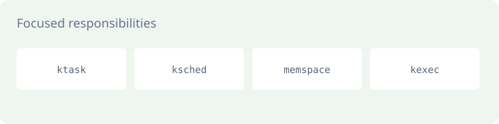

Opening a kernel repository usually reveals directories for memory, tasks, filesystems, and drivers. Directories help us find code. They do not, by themselves, tell us who owns a piece of state, who maintains an invariant, or which callers must change when an implementation changes.

X-kernel organizes components as Rust crates. Understanding that organization starts with boundaries, rather than the number of crates.

## A monolithic kernel can have clear components

A monolithic kernel describes how major system services cooperate in kernel space. Componentization describes how implementations are separated, interfaces exposed, and dependencies organized. The components can still be linked into a single kernel image.

A crate is therefore not a separate process and does not automatically provide runtime isolation. Its first contribution is a code and interface boundary: which types are public, which state remains private, and who may change that state.

## Reading ktask and ksched together

In the current source, `ktask` depends on `ksched`. The former handles task management; the latter supplies scheduling algorithms through a unified interface. This separation lets us discuss “what a task is” separately from “which task should be selected next.”

Read the pair with three questions in mind: what information does a policy receive, what choice does it produce, and which side owns task-state transitions? Find the answers in interfaces and implementations rather than inferring them from directory names.

This is a reading strategy, not a promise that changing a scheduler requires no integration work. Execution context, preemption, and concurrency constraints still need attention.

## Boundaries extend beyond functions

Consider address spaces. `memspace` owns address-space logic, while `kexec` handles user program loading and execution image setup. They cooperate, but touching memory is not a sufficient reason to combine them into an all-purpose common crate.

A coherent component brings together the data it owns, the invariants it maintains, resource creation and destruction, and the contexts in which it can be called. Small private implementation details often work well as internal modules.

When several peer components actually need a capability with its own responsibility, give it a focused public interface. The resulting crate then has a durable reason to exist.

## Directed dependencies make changes traceable

When two components both need to understand each other's internal state, changes become difficult to contain. A dependency graph helps readers follow where a capability comes from.

An acyclic design is not simply a competition to draw fewer edges. Each dependency should be explainable: which capability does the caller require? Does the interface expose implementation details? Has a reusable policy become tied to one platform?

Cargo dependencies are a useful starting point, but they cannot describe all runtime behavior. Callbacks, lock ordering, and shared state still require reading code and design documentation.

## Start with one component

Try reading the public interface of `task/ksched`, then examine how `task/ktask` uses it. Pick one path and trace its inputs, state transitions, and result.

You do not need to understand the entire kernel at once. Understand one boundary, then follow the interface across it.

Continue with [What is X-kernel?](/docs/en/what-is-x-kernel) or the [source repository](https://gitee.com/openkylin/x-kernel).

*This article reflects component organization and Cargo dependencies in the current repository, not a complete architecture specification. Consult your checked-out revision for exact interfaces.*
