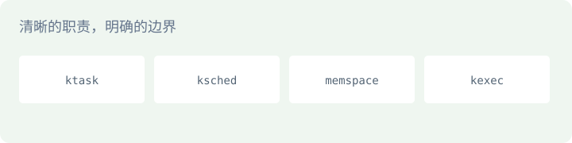

打开一个内核仓库，最先看到的往往是目录：内存、任务、文件系统、驱动。目录能帮助我们找到代码，却不能单独回答更重要的问题：一项状态由谁管理，一条约束由谁保证，一个组件发生变化时，哪些调用者必须跟着修改？

X-kernel 使用 Rust crate 组织组件。理解这种组织方式，可以从“边界”开始，而不是从组件数量开始。

## 宏内核也可以有清晰的组件

宏内核描述主要系统服务在内核空间中的协作方式。组件化则描述实现如何拆分、接口如何暴露、依赖如何组织。一个组件化宏内核仍然可以将这些组件链接到同一个内核镜像里。

因此，crate 不等于独立进程，也不自动带来运行时隔离。它首先提供的是代码与接口的边界：哪些类型可以被外部访问，哪些状态应当留在内部，谁有权改变它们。

## 从 ktask 和 ksched 看分工

在当前源码中，`ktask` 依赖 `ksched`。前者承担任务管理，后者提供统一接口下的调度算法。这种分工让“任务是什么”和“下一次选择哪个任务”可以分别讨论。

查看这两个 crate 时，可以沿着三个问题阅读：调度策略接收什么信息？策略产生什么选择？任务状态的改变由哪一侧负责？答案应当在接口与实现中找到，而不是由目录名称推断。

这里展示的是阅读方法，不意味着更换调度策略完全不需要集成工作。执行上下文、抢占和并发约束仍需要一起检查。

## 边界不只围绕函数划分

以地址空间为例，`memspace` 负责地址空间逻辑；用户程序加载与执行镜像准备属于 `kexec`。两者存在协作，但不必因为都会接触内存，就被塞进一个无所不包的公共 crate。

一个合理的组件通常会把以下内容放在一起：它拥有的数据、必须维护的不变量、资源的创建与释放，以及调用时的上下文要求。只在内部使用的小实现，保留为 `mod` 往往已经足够。

反过来，当多个同级组件确实需要一项有独立职责的能力时，再为它建立明确的公共接口。这样拆分出来的 crate 才有稳定的存在理由。

## 单向依赖，让变化可以追踪

如果两个组件都需要了解对方的内部状态，修改其中一个就很难局限在一个边界内。依赖图的价值，在于让读者能够顺着方向追踪能力的来源。

有向无环的设计不是“连线越少越好”。更重要的是每一条依赖能否解释：调用者需要的究竟是哪项能力？接口有没有把实现细节暴露出去？原本独立的策略是否被绑定到了某个平台？

Cargo 中的依赖关系可以作为阅读起点，但依赖清单无法表达全部运行时行为。回调、锁顺序和共享状态，还需要回到代码和设计文档检查。

## 从一个组件读起

第一次阅读源码，不妨先选择 `task/ksched`，查看它的公开接口，再看 `task/ktask` 如何使用它。随后选一个调用路径，追踪输入、状态变化和返回结果。

不需要在开始时理解整个内核。先弄清一个边界，再跨过它，阅读会更有方向。

继续阅读：[认识 X-kernel](/docs/zh-CN/what-is-x-kernel) · [源码仓库](https://gitee.com/openkylin/x-kernel)

*本文依据当前仓库的组件划分与 Cargo 依赖编写，不是完整架构规范；具体接口以检出的源码版本为准。*
