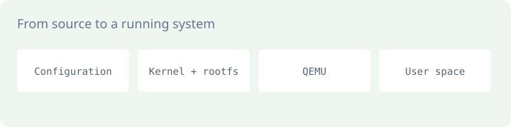

On the first run of an operating-system project, it is easy to focus on the final shell prompt. It means the system accepts input. Before it appears, however, configuration, build tools, the kernel, devices, and user space have already performed a sequence of handoffs.

Separating those roles makes booting more understandable than “run make run and wait.”

## Configuration selects the system to build

The same X-kernel source can target different architectures and platforms. Before building, decide where this kernel will run and which capabilities it should enable.

The AArch64 QEMU example begins with a platform configuration:

```bash
cp platforms/kplat-aarch64/qemu_defconfig .config
make defconfig
```

The first command selects the platform's minimal configuration; the second expands it into a complete configuration. `.config` is an input to the build, not an incidental record. Save any custom configuration before replacing it.

## The kernel and rootfs are separate

The kernel manages resources, handles system calls, and coordinates devices. The root filesystem supplies user programs and files. Kernel startup messages do not prove that the image's shell is usable; preparing a rootfs does not build the kernel either.



The current introductory workflow prepares them separately:

```bash
make rootfs
make build
make run
```

`make rootfs` obtains a prebuilt filesystem image, `make build` produces the configured kernel, and `make run` starts QEMU using the platform settings. See [Quick Start](/docs/en/quick-start) for prerequisites and the full procedure.

## QEMU supplies a repeatable machine

QEMU provides the machine environment. CPU architecture, memory, devices, and serial-console settings shape the conditions the kernel encounters. The kernel still performs its own initialization and interacts with devices through appropriate drivers.

This distinction also explains why AArch64 support does not imply support for every ARM board. The platform and device combination matters.

## Read logs as a timeline

Identify the stage before interpreting the error. Did the build finish? Did QEMU start? Is there kernel serial output? Did the failure occur during initialization or after entering user space?

These questions narrow the search more effectively than the last error line alone. A missing QEMU executable is a host-environment issue, not an immediate reason to edit kernel code. An image download failure calls for checking the network, file paths, and available disk space.

With a rootfs that supplies a shell, `pwd` and `ls /` help confirm that user space is running. The username and hostname in the prompt belong to the image environment; they do not reliably identify a kernel revision.

## Keep a baseline after the first success

Record the source revision, defconfig, toolchain versions, and image source. Change one configuration choice or behavior at a time, then compare the result.

If a later run fails, you can explain what changed since the successful run rather than reconstructing the entire environment from guesses.

Booting is a milestone worth recording and a starting point for reading the system. A useful next step is to connect one log message to the code that emits it, then understand how that stage hands control to the next.

*This article explains the current repository workflow. It does not claim a new full kernel build or performance measurement was performed for this post. See [Getting Help](/docs/en/getting-help) for collecting reproduction details.*
