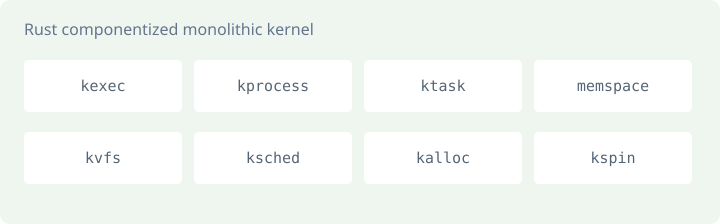

# What is X-kernel?

X-kernel is an open-source, multi-architecture monolithic operating-system kernel written in Rust. Its components provide memory management, processes and task scheduling, filesystems, networking, device drivers, and trusted execution environment (TEE) support.

## Componentized. Modular.

A monolithic kernel describes how system services run: major subsystems cooperate in kernel space. Componentization describes how code is organized: Rust crates encapsulate responsibilities and expose interfaces for composition. These properties can coexist. A crate boundary does not itself provide process isolation or a security boundary.

Component boundaries should account for data ownership, invariants, lifecycle, and execution context. Implementation details used by only one crate can remain internal modules; every directory does not need to become a separate crate.

A few starting points in the source tree:

| Component | Responsibility | Source location |
| --- | --- | --- |
| `kexec` | User program loading and execution image setup | `process/kexec/` |
| `memspace` | Address-space management | `mm/memspace/` |
| `ktask` | Task management | `task/ktask/` |
| `ksched` | Scheduling policies | `task/ksched/` |
| `kvfs` | Virtual filesystem | `fs/kvfs/` |

Dependencies should be explicit and directed, avoiding cycles. The illustration groups components rather than documenting the full dependency graph. Consult each crate's `Cargo.toml` for its actual dependencies.

## Architectures and platforms

The project includes support for AArch64, x86_64, RISC-V 64, and LoongArch64. Platforms include QEMU, Hygon CSV, and Kylin-x Pkvm environments. Architecture support does not mean every board or device boots out of the box: capabilities depend on the platform configuration, drivers, and revision.

For your first boot, use **AArch64 with QEMU**. Complete one known configuration path before exploring other platforms.

## Secure, independent, trustworthy

Rust's type system and ownership model help reduce memory-safety errors. Kernel development still involves `unsafe`, hardware access, and concurrency, so language choice does not replace interface constraints, review, or testing.

TEE availability and isolation guarantees depend on the platform and configuration. Booting the ordinary QEMU example does not establish a trusted execution environment.

The source is available under Apache-2.0. The project README describes its relationship to StarryOS and ArceOS; consult LICENSE and NOTICE in the repository for licensing and attribution.

## Next steps

- Follow [Quick Start](quick-start.en.md) to build and boot the kernel.
- Explore the implementation in the [Gitee repository](https://gitee.com/openkylin/x-kernel).
- Read [Getting Help](getting-help.en.md) if you encounter a problem.
