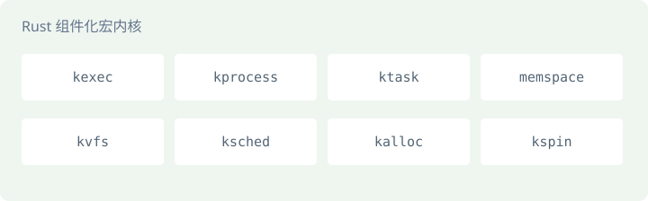

# 认识 X-kernel

X-kernel 是一个使用 Rust 开发的多架构开源宏内核操作系统。它以组件组织系统能力，覆盖内存管理、进程与任务调度、文件系统、网络、设备驱动和可信执行环境（TEE）。

## 组件化，模块化

宏内核描述系统服务的运行方式：主要子系统在内核空间协作。组件化描述代码的组织方式：以 Rust crate 为边界，封装职责，通过接口组合能力。两者并不矛盾；crate 边界本身也不等同于进程隔离或安全隔离。

划分组件时，需要一起考虑数据归属、状态约束、生命周期和执行上下文。仅供一个 crate 使用的实现细节可以保持为内部模块，不必每个目录都拆成独立 crate。

下面是几个源码入口：

| 组件 | 职责 | 源码位置 |
| --- | --- | --- |
| `kexec` | 用户程序加载与执行镜像准备 | `process/kexec/` |
| `memspace` | 地址空间管理 | `mm/memspace/` |
| `ktask` | 任务管理 | `task/ktask/` |
| `ksched` | 调度策略 | `task/ksched/` |
| `kvfs` | 虚拟文件系统 | `fs/kvfs/` |

依赖关系应保持明确、单向，避免循环依赖。上图只展示组件分组，不代表完整依赖图；具体依赖以各 crate 的 `Cargo.toml` 为准。

## 架构与平台

项目包含 AArch64、x86_64、RISC-V 64 和 LoongArch64 的架构支持。平台包括 QEMU，以及海光 CSV、Kylin-x Pkvm 等环境。架构支持不意味着任意设备或板卡都可以直接启动，实际能力取决于平台配置、驱动与当前版本。

第一次运行建议选择 **AArch64 + QEMU**，沿着一条确定的配置路径完成启动，再探索其他平台。

## 安全、自主、可信

Rust 的类型系统和所有权机制有助于减少内存安全错误。内核仍然需要处理 `unsafe`、硬件访问和并发问题，因此语言选择不能替代接口约束、代码审查和测试。

TEE 是项目的一项能力，其可用性和隔离保证取决于具体平台与配置。运行普通 QEMU 示例并不等同于建立了可信执行环境。

项目以 Apache-2.0 许可证开放源码。项目 README 说明了与 StarryOS、ArceOS 的技术渊源，依赖与许可信息请参阅仓库中的 LICENSE 和 NOTICE。

## 接下来

- 跟随[快速开始](quick-start.zh.md)，构建并启动内核。
- 在 [Gitee 仓库](https://gitee.com/openkylin/x-kernel)阅读实现。
- 遇到问题时，参阅[获取帮助](getting-help.zh.md)。
