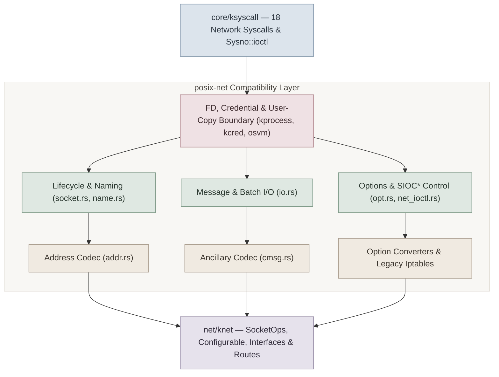

# posix-net — Design Document

## Positioning

`posix-net` is the POSIX/Linux network syscall layer in X-Kernel. It sits between the syscall table in `core/ksyscall` and the network stack in `net/knet`. Its job is to convert raw Linux socket syscall arguments into typed calls on kernel sockets, file descriptors, credentials, and network interfaces.

## Background

Linux network syscalls have many ABI rules that differ by syscall and address family. For example:

- `sendmsg(2)` limits a too-large `msg_namelen` to `sizeof(struct sockaddr_storage)` before checking the family, while `sendto(2)` rejects it directly.
- `bind(2)` and `connect(2)` on `AF_NETLINK` return `EINVAL` for a wrong family, while other families return `EAFNOSUPPORT`.
- `getsockopt(2)` cuts data to fit a short buffer for socket identity options (`SO_TYPE`, `SO_DOMAIN`, `SO_PROTOCOL`, `SO_PEERCRED`), while fixed-size options reject short buffers.
- `SCM_CREDENTIALS` checks the sender's claimed IDs in the sender's user and PID namespaces, then maps them into the receiver's namespaces when delivering the message.

Keeping these Linux ABI rules in `posix-net` lets `knet` stay clean with Rust traits (`SocketOps`, `Configurable`, `SocketAddrEx`, `AncillaryData`), while giving user-space programs (such as `libc`, Go, `containerd-shim`, `ip`, and `iptables-legacy`) the behavior they expect.

## Scope

```text
posix/net/
├── Cargo.toml
├── src/
│   ├── lib.rs              # Crate entry, public re-exports, net_capable() helper
│   ├── socket.rs           # socket, socketpair, bind, connect, listen, accept, accept4, shutdown
│   ├── name.rs             # getsockname, getpeername
│   ├── io.rs               # sendto, recvfrom, sendmsg, recvmsg, sendmmsg, recvmmsg
│   ├── opt.rs              # getsockopt, setsockopt, type converters, classic-BPF validator
│   ├── net_ioctl.rs        # handle_net_ioctl for exact SIOC* interface and route commands
│   ├── addr.rs             # SocketAddrExt user-memory codecs per address family
│   ├── cmsg.rs             # cmsghdr parser/builder, SCM_RIGHTS budget, SCM_CREDENTIALS, IP_RECVERR
│   └── legacy_iptables.rs  # IPPROTO_IP legacy iptables socket options (IPT_SO_*)
├── ut-tests/               # Kernel unit tests mounted via unittest::path_mod_test!
└── docs/
    ├── design.md
    └── security.md
```

| Module | Responsibility |
|---|---|
| `socket` | Creates sockets for `AF_INET`, `AF_UNIX`, `AF_NETLINK`, `AF_PACKET`, and optional `AF_VSOCK` (`AF_INET6` returns `EAFNOSUPPORT`); handles connection setup, `AF_UNIX` `socketpair`, and `shutdown`. |
| `name` | Reads local bound addresses (`getsockname`) and remote peer addresses (`getpeername`). |
| `io` | Handles single, vectored, and batch socket I/O, and links POSIX control messages with `knet` ancillary data. |
| `opt` | Handles socket, IP, TCP, Netlink, and Packet options, including short-buffer identity queries, classic-BPF checks, and `timeval`-to-tick rounding. |
| `net_ioctl` | Handles 10 exact `SIOC*` interface and IPv4 route `ioctl` commands before falling back to generic VFS `ioctl`. |
| `addr` | Converts between user-space `sockaddr` buffers and `knet::SocketAddrEx`, checking family length rules. |
| `cmsg` | Copies and parses send-side `cmsghdr` chains, enforces the `SCM_MAX_FD` (253) limit, checks `SCM_CREDENTIALS`, and writes receive-side control buffers. |
| `legacy_iptables` | Copies and checks `IPT_SO_GET_*` and `IPT_SO_SET_*` payloads on `AF_INET` sockets for `knet`. |

## Architecture

Every entry point follows the same layered path: first look up the fd/credentials and copy user memory safely, then parse Linux ABI structs and check capabilities, and finally call `knet`.



### Supported Protocol Matrix

- **`AF_INET`**: `SOCK_STREAM` (TCP), `SOCK_DGRAM` (UDP), and `SOCK_RAW` (needs `CAP_NET_RAW` in the current network namespace).
- **`AF_UNIX`**: `SOCK_STREAM`, `SOCK_SEQPACKET`, and `SOCK_DGRAM` (both `socket` and `socketpair`; `proto` must be `0` or `AF_UNIX`).
- **`AF_NETLINK`**: `SOCK_RAW` and `SOCK_DGRAM` for protocols below `NETLINK_MAX_LINKS` that pass `knet::netlink::netlink_protocol_supported`.
- **`AF_PACKET`**: `SOCK_RAW` and `SOCK_DGRAM` (needs `CAP_NET_RAW`; protocol must fit in `u16`).
- **`AF_VSOCK`**: `SOCK_STREAM` when the `vsock` Cargo feature is enabled.
- **`AF_INET6`**: Rejected with `EAFNOSUPPORT` in `sys_socket` until full IPv6 support is ready (`addr.rs` still keeps `SocketAddrV6` codec code).

## Calling Constraints / Execution Context

All public functions in `posix-net` are syscall entry points and must run in a normal user-thread task context:

- **Must be sleepable and reclaim-safe**: Entry points copy user memory (which may trigger page faults and sleep), allocate heap memory (`KBox`, `Vec`), and wait on socket locks or I/O queues. Never call them in IRQ context or while holding spinlocks, preempt-disable guards, or locks needed by page faults and memory reclaim.
- **Not valid during early boot**: Depends on the scheduler, user memory copy (`osvm`), VFS files (`kvfs`), process fd tables (`kprocess`), and `knet`.
- **Needs a current user thread**: Calls like `kprocess::current_files()`, `kprocess::current_cred()`, and `kprocess::current_user_thread()` will panic in a pure kernel thread with no user process.
- **No fd-table lock during blocking or allocation**: `sys_socket`, `sys_socketpair`, and `sys_accept4` allocate `KBox` sockets and `VfsFile` objects *before* taking the fd-table lock to add descriptors. Nonblocking flags (`O_NONBLOCK`, `MSG_DONTWAIT`) stop I/O from waiting on peers, but socket allocation in `sys_accept4` still needs a sleepable context.

## Algorithm Flow

### 1. Socket Creation and Connection Setup

1. **`sys_socket` / `sys_socketpair`**: Use the low 8 bits of `raw_ty` to pick the socket type, check `CAP_NET_RAW` via `net_capable` when needed, build `knet::Socket` in a fallible `KBox`, wrap it in a `VfsFile` with `O_RDWR | (raw_ty & O_NONBLOCK)` and the current credentials, and add the fd(s) with `O_CLOEXEC` if set.
2. **`sys_bind` / `sys_connect`**: Look up `fd` *before* reading user memory so a bad fd returns `EBADF`/`ENOTSOCK` before `EFAULT`. Parse the address based on the socket's own family:
   - `AF_NETLINK` uses `NetlinkAddr::read_from_user` on `bind` and `read_netlink_connect_addr` on `connect` (allows `AF_UNSPEC` to disconnect and returns `EINVAL` for other families).
   - `AF_UNIX` uses `read_unix_bind_addr` on `bind` so a 2-byte family-only `sockaddr_un` triggers autobind, while send/connect addresses still need at least one `sun_path` byte.
   - Other families use `SocketAddrEx::read_from_user`.
3. **`sys_accept4` (`sys_accept` calls it with `flags = 0`)**: Look up the listening socket without holding the fd-table lock, accept a new `Socket`, create its `VfsFile` and fd, and write back the peer address only if `addr` is not null.

### 2. Send and Control-Message Path

```mermaid
flowchart LR
    classDef step fill:#DCE4EC,stroke:#7D92A6,stroke-width:1.2px,color:#2D3640
    classDef guard fill:#EFE1E4,stroke:#AD8289,stroke-width:1.2px,color:#3F2D30
    classDef codec fill:#F0EAE1,stroke:#A89B8C,stroke-width:1.2px,color:#3B352E
    classDef owner fill:#DFE8E2,stroke:#7E9987,stroke-width:1.2px,color:#2B3830

    S1["1. Look Up Socket FD"]:::step
    S2["2. Copy Header & IoVecs"]:::codec
    S3["3. Copy & Check cmsg"]:::guard
    S4["4. Parse Target Addr"]:::codec
    S5["5. knet Send (with Creds)"]:::owner

    S1 --> S2 --> S3 --> S4 --> S5
```



Key rules on the send path:

- **FD lookup runs first**: `sys_sendmsg` and `sys_sendmmsg` call `lookup_send_socket` before reading `msghdr`, matching Linux `sockfd_lookup_light()`. Even `sendmmsg(bad_fd, ..., vlen = 0)` returns `EBADF`.
- **Name length limit**: `sys_sendmsg` and `sys_sendmmsg` reject negative `msg_namelen` (`EINVAL`), ignore `msg_namelen` when `msg_name` is null, and cap larger lengths at `MAX_SOCKADDR_LEN` (128 bytes) before family checks. `sys_sendto` passes raw `addrlen` without capping.
- **One-shot control buffer copy**: `parse_send_cmsgs` rejects `msg_controllen >= OPTMEM_MAX` (128 KiB) with `ENOBUFS`, copies the full control buffer into a kernel `Vec<u8>`, and walks `cmsghdr` entries in one pass:
  - `SCM_RIGHTS` (allowed on `AF_UNIX`, rejected with `EINVAL` on `AF_NETLINK`) looks up each fd during the walk and tracks a per-call `ScmFdBudget` up to `SCM_MAX_FD` (253).
  - `SCM_CREDENTIALS` (allowed on `AF_UNIX` and `AF_NETLINK`) checks the claimed `ucred` against the caller's namespaces and capabilities (`check_creds`), keeping the last valid claim.
- **Batch `sendmmsg` loop**: `vlen` is capped at `MMSG_MAX_VLEN` (1024). Entries are read, sent, and updated (`msg_len`) one by one. If a later entry fails or sends fewer bytes than requested, the loop stops and returns how many messages succeeded; an error is returned only if zero messages were sent.

### 3. Receive and Ancillary Delivery Path

```mermaid
flowchart LR
    classDef step fill:#DCE4EC,stroke:#7D92A6,stroke-width:1.2px,color:#2D3640
    classDef owner fill:#DFE8E2,stroke:#7E9987,stroke-width:1.2px,color:#2B3830
    classDef codec fill:#F0EAE1,stroke:#A89B8C,stroke-width:1.2px,color:#3B352E
    classDef guard fill:#EFE1E4,stroke:#AD8289,stroke-width:1.2px,color:#3F2D30

    R1["1. Look Up FD & RecvFlags"]:::step
    R2["2. knet::Socket::recv"]:::owner
    R3["3. Write Peer Address"]:::codec
    R4["4. Build cmsg & Map IDs"]:::guard
    R5["5. Write Output Fields"]:::codec

    R1 --> R2 --> R3 --> R4 --> R5
```



Key rules on the receive path:

- **Unix control drop when no buffer is given**: If `msg_control` is null on an `AF_UNIX` socket, `recv_impl` passes `ancillary: None` so the transport drops queued control data/fds at once and sets `MSG_CTRUNC`. This stops old fds from leaking into a later `recvmsg`.
- **Namespace ID mapping on receive**: `SCM_CREDENTIALS` maps the sender's `Process` identity into the receiver's active PID namespace (`0` if not visible) and maps initial-namespace UID/GID into the receiver's user namespace (`65534` if unmapped).
- **Safe `msghdr` writeback**: `write_recvmsg_outputs` writes only `msg_namelen`, `msg_controllen`, and `msg_flags` (plus `msg_len` in `recvmmsg`) using `offset_of!`, so unused struct padding is never written to user space.

### 4. Socket Options and Network `ioctl`

- **`sys_getsockopt` / `sys_setsockopt`**: Look up `fd` first, then read `optlen` and reject negative values (`EINVAL`). Special options run before the `call_dispatch!` macro table:
  - `IPPROTO_IP` options `64..=67` go to `legacy_iptables` (`AF_INET` + `CAP_NET_ADMIN`).
  - `SO_TYPE`, `SO_DOMAIN`, `SO_PROTOCOL`, and `SO_PEERCRED` cut output to fit short buffers (`put_truncated*`), matching Linux `sk_getsockopt`.
  - `IP_PKTINFO`, `IP_RECVTTL`, `IP_RECVTOS`, `IP_RECVFRAGSIZE`, and `IP_MULTICAST_TTL` accept either a 4-byte `int` or a 1-byte `u8` (`set_ip_length_tolerant`).
  - `SO_ATTACH_FILTER` / `SO_DETACH_FILTER` check classic-BPF instructions on `NETLINK_KOBJECT_UEVENT` sockets as a compatibility stub.
- **`handle_net_ioctl`**: Matches an exact list of 10 `SIOC*` commands (`SIOCGIFINDEX`, `SIOCGIFHWADDR`, `SIOCGIFFLAGS`, `SIOCGIFADDR`, `SIOCSIFADDR`, `SIOCSIFNETMASK`, `SIOCSIFBRDADDR`, `SIOCSIFFLAGS`, `SIOCADDRT`, `SIOCDELRT`). Unknown commands return `Ok(None)` so `ksyscall` passes them to `posix-fs::sys_ioctl`. Matched commands check that `fd` is a socket (`ENOTTY` otherwise) and require `CAP_NET_ADMIN` for the 6 write commands.

## Concurrency Model

`posix-net` has no global mutable state and no module-local locks:

- **Short fd-table lock hold**: `kprocess::current_files().get_file(fd)` clones `Arc<VfsFile>` and releases the fd-table lock right away, before any user copy or blocking socket call.
- **Control-buffer snapshot**: Copying `msg_control` into a kernel `Vec<u8>` up front stops other user threads from changing `cmsg_len` during parsing (prevents TOCTOU bugs).
- **Shared file handles on `MSG_PEEK`**: `AncillaryData` holds `Arc<CMsg>` with `Vec<Arc<VfsFile>>`. Peeking clones the `Arc<VfsFile>` references and installs new fds without reopening files.

## Design Decisions

### FD Lookup Before Header Copy

Linux resolves the socket fd before reading `msghdr`, `optlen`, or `sockaddr` in `connect`, `sendmsg`, `sendmmsg`, `getsockopt`, and `setsockopt`. Keeping this order ensures tests and apps see `EBADF`/`ENOTSOCK` instead of `EFAULT` or `EINVAL` when both the fd and pointer are bad.

### Exact `SIOC*` Command List Instead of `0x89xx` Range

Socket files do not yet override VFS `ioctl`, so `ksyscall` calls `handle_net_ioctl` first. Matching only the 10 supported `SIOC*` commands—instead of catching all `0x89xx` codes—lets other `ioctl` commands fall through cleanly to `posix-fs`.

### Type-Erased Ancillary Boundary

To keep `knet` free of POSIX `cmsghdr` and `VfsFile` types, ancillary items cross the boundary as `Arc<dyn Any + Send + Sync>` (`AncillaryData`). `posix-net` downcasts `CMsg::Rights` and `KernelAncillaryData` (`IpError`, `Credentials`) in `into_socket_ancillary`.

### Tick-Rounded Socket Timeouts

Linux stores nonzero `SO_RCVTIMEO` and `SO_SNDTIMEO` values in jiffies. `conv::SocketTimeout` rounds positive `timeval` values up to the next `kbuild_config::TICKS_PER_SECOND` tick (capping at `TimeSpan::MAX` on overflow) so small timeouts do not become zero.

### Kernel Unit-Test Layout

Unit tests live under `ut-tests/` and are mounted in their parent modules with `unittest::path_mod_test!`. They run inside the guest kernel via `make unittest`, testing real user memory mappings and task credentials.

## Drop and Resource Release

`posix-net` has no custom `Drop` types. Cleanup relies on normal Rust drop and explicit fd rollback:

- **Creation failure**: If `KBox::new` or `sock_alloc_file` fails in `sys_socket` or `sys_socketpair`, the half-built socket/file drops before touching the fd table.
- **`socketpair` rollback**: If adding the second fd fails in `sys_socketpair`, `resources.close_file(fd1)` closes the first fd.
- **Failed `SCM_RIGHTS` send**: Files collected in `parse_send_cmsgs` are stored as `Arc<VfsFile>`. If a later check or send fails, dropping the local `Vec<AncillaryData>` releases all file references cleanly.
