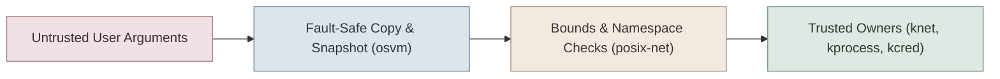
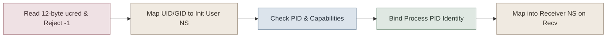

# posix-net — Security and Reliability Analysis

## Overview

`posix-net` is the security boundary between untrusted user-space network syscalls and X-Kernel's network stack (`knet`), process fd tables (`kprocess`), and credential/namespace checks (`kcred`).

Its main risk areas are:

1. **Untrusted user pointers and nested ABI structs** (`sockaddr_*`, `msghdr`, `mmsghdr`, `cmsghdr`, `ifreq`, `rtentry`, `sock_fprog`, legacy `iptables` buffers).
2. **Namespace-scoped network capabilities** (`CAP_NET_RAW`, `CAP_NET_ADMIN`) and cross-process credential/fd passing (`SCM_CREDENTIALS`, `SO_PEERCRED`, `SCM_RIGHTS`).
3. **Kernel-to-user data output**, where uninitialized struct padding or unmapped namespace IDs could leak kernel memory or host identity.

This crate has a small set of `unsafe` blocks, used only for POD byte-slice views, unaligned reads/writes on checked kernel slices, and `UserRead`/`UserWrite` POD traits.

## Trust Model

- **User inputs are untrusted**: pointers may be null, unmapped, misaligned, read-only, or changed by another thread at the same time; lengths and counts may be negative, zero, or crafted to overflow or trigger huge allocations.
- **`osvm` and `posix-types` are trusted** to check virtual address bounds and catch page faults in `read_vm`, `write_vm`, `load_vm_vec`, and `IoVectorBuf`.
- **`kprocess` and `kcred` are trusted** to provide current-thread credentials, thread-safe fd tables, and user/PID/network namespace ownership.
- **`knet` is trusted** to keep transport state, socket buffer limits, and internal locks safe once validated Rust values cross the boundary.

## External Boundaries / Attack Surface

This crate does **not** touch MMIO/PIO registers, DMA buffers, hardware IRQs, firmware/ACPI/DTB tables, FFI functions, or inline assembly. All external inputs come from user-space syscall arguments or from `knet` outputs being copied back to user space.

| Boundary | Entry Points | Untrusted Inputs & Risks | Local Controls |
|---|---|---|---|
| Socket creation | `sys_socket`, `sys_socketpair` | Any `domain`, `type`, `proto`, flags | Fixed family/type allowlist; `CAP_NET_RAW` via `net_capable` for `AF_INET`/`AF_PACKET` raw and packet sockets; `AF_NETLINK` protocol check; `AF_INET6` rejected (`EAFNOSUPPORT`). |
| Socket addresses | `bind`, `connect`, `sendto`, `sendmsg`, `getsockname`, `getpeername`, `accept4`, `recv*` | `addr` pointer, `addrlen` / `msg_namelen` | `MAX_SOCKADDR_LEN` (128 B) cap; negative `msg_namelen` rejected before casting; `UnixAddr` bounded to `(2, sizeof(sockaddr_un)]`; `fill_addr` cuts output to caller's `addrlen`. |
| Vectored & batch I/O | `sendmsg`, `recvmsg`, `sendmmsg`, `recvmmsg` | `msghdr`, `mmsghdr` array, `msg_iov`, `vlen`, `timeout` | FD checked first; `vlen` capped at `MMSG_MAX_VLEN` (1024); `IoVec::load_from_user` checks scatter/gather buffers; `write_recvmsg_outputs` writes fields one by one via `offset_of!`. |
| Control messages (`cmsg`) | `sendmsg`, `sendmmsg`, `recvmsg`, `recvmmsg` | `msg_control`, `msg_controllen`, `SCM_RIGHTS` fds, `SCM_CREDENTIALS` `ucred` | Send buffer must be `< OPTMEM_MAX` (128 KiB) and is copied into kernel `Vec<u8>`; `cmsg_align` and `checked_add` prevent overflow; `ScmFdBudget` caps total fds per call at `SCM_MAX_FD` (253). |
| Socket options | `getsockopt`, `setsockopt` | `level`, `optname`, `optval`, `optlen`, `SockFprog` | Rejects negative `optlen as i32`; `SO_SNDBUFFORCE`/`SO_RCVBUFFORCE` need `CAP_NET_ADMIN`; changing an active `SO_BINDTOIFINDEX` needs `CAP_NET_RAW`; Netlink group join checks `allows_unprivileged_group_subscribe()` or `CAP_NET_ADMIN`; `SO_ATTACH_FILTER` limits instructions to `1..=4096` with forward-only jumps ending in `BPF_RET`. |
| Legacy `iptables` | `getsockopt` / `setsockopt` (`IPPROTO_IP`, `64..=67`) | `IptGetEntries`, `IptReplace`, `XtCountersInfo` blobs | `check_access` requires `AF_INET` (`ENOPROTOOPT` otherwise) and `CAP_NET_ADMIN` (`EPERM`); `zerocopy` parses headers and `checked_add` checks extra payload length. |
| Network `ioctl` | `handle_net_ioctl` | `Ifreq`, `Rtentry`, nested `rt_dev` string pointer | Exact 10-command `SIOC*` list; non-socket fd returns `ENOTTY`; 6 write commands need `CAP_NET_ADMIN`; `rt_dev` limited to `IFNAMSIZ - 1` (15 bytes); route netmask and host bits checked. |

### `SCM_CREDENTIALS` Check and Namespace Mapping

Passing credentials across sockets is a key security boundary because the sender and receiver may be in different user and PID namespaces.

1. **Invalid ID check**: `check_creds` (`src/cmsg.rs:353`) rejects `u32::MAX` (`(uid_t)-1`) and unmapped local UIDs/GIDs with `EINVAL` before capability checks.
2. **Sender capability check**: Claiming another PID needs `CAP_SYS_ADMIN` in the caller's active PID namespace owner (and that PID must exist there, else `ESRCH`); claiming a UID/GID outside the caller's real/effective/saved IDs needs `CAP_SETUID`/`CAP_SETGID` in the caller's user namespace, else `EPERM`.
3. **Receiver mapping**: On `recvmsg` (`src/io.rs:242`) and `SO_PEERCRED` (`src/opt.rs:471`), stored IDs are mapped into the *receiver's* active PID namespace (`0` if not visible) and user namespace (`65534` if unmapped). Netlink sends also pass both `opener_cred` (`file.cred()`) and current `sender` credentials so an unprivileged process cannot misuse a passed privileged fd.

## `unsafe` Code Inventory

Every `unsafe` block and `unsafe impl` in `posix-net` is listed below:

| Location | Item / Operation | Call Path | Invariant & Safety Reason |
|---|---|---|---|
| `src/addr.rs:64-68` | `unsafe fn cast_to_slice<T>` (`slice::from_raw_parts`) | Internal helper for `SocketAddrExt::write_to_user` | All bytes of `value` (including padding) must be initialized and immutable. Safe because it only borrows stack-local structs for read-only copyout. |
| `src/addr.rs:127, 167, 301, 350, 383` | `cast_to_slice` on `sockaddr_in`, `sockaddr_in6`, `sockaddr_nl`, `sockaddr_ll`, `sockaddr_vm` | `write_to_user` in `bind`/`accept4`/`recv*`/`getsockname`/`getpeername` | Each `#[repr(C)]` struct is built on the stack with all fields and padding arrays (`__pad`, `nl_pad`, `svm_reserved1`, `svm_zero`) set to zero, leaving no uninitialized holes. |
| `src/addr.rs:146` | Union field read `addr_in6.sin6_addr.in6_u.u6_addr8` | `SocketAddrV6::read_from_user` | `addr_in6` was filled by `read_vm()` after checking `addrlen >= size_of::<sockaddr_in6>()`; `[u8; 16]` allows any byte values. |
| `src/addr.rs:318` | `unsafe impl UserRead for sockaddr_ll` | `PacketAddr::read_from_user` | `sockaddr_ll` is a 20-byte `#[repr(C)]` POD struct of integers and `[u8; 8]` with no invalid bit patterns. |
| `src/cmsg.rs:47` | `unsafe impl NoUninit for SockExtendedErr` | `write_sock_extended_err` (`IP_RECVERR`) | `#[repr(C)]` integer struct (`u32, u8, u8, u8, u8, u32, u32`); compile-time check at line 41 confirms size is 16 bytes with no padding. |
| `src/cmsg.rs:95-97` | `ptr::write_unaligned` of `sockaddr_in` | `write_sockaddr_in` (`IP_RECVERR`) | Line 72 checks `data.len() >= size_of::<sockaddr_in>()`; `sa` sets `__pad: [0; 8]`; `write_unaligned` works on any byte-slice alignment. |
| `src/cmsg.rs:219` | `ptr::read_unaligned` of `cmsghdr` | `read_cmsghdr` in `parse_control_msgs` | Line 286 checks `remaining >= size_of::<cmsghdr>()` on an initialized kernel slice; `cmsghdr` holds plain integers only. |
| `src/cmsg.rs:359` | `ptr::read_unaligned` of `ucred` | `check_creds` in `parse_control_msgs` | Line 354 checks `body.len() == size_of::<ucred>()` on an initialized kernel slice; `ucred` holds three `u32` fields. |
| `src/net_ioctl.rs:38, 40, 71, 73, 293` | `unsafe impl UserRead` / `UserWrite` for `Sockaddr`, `Ifreq`, `Rtentry` | `handle_net_ioctl` handlers | All three structs derive `bytemuck::Pod` and `bytemuck::Zeroable` with explicit padding arrays covering every byte. |
| `src/opt.rs:69, 80, 200, 230` | `unsafe impl UserRead` for `SockFilter`, `SockFprog`, `tpacket_stats`, `packet_mreq` | `sys_setsockopt` / `sys_getsockopt` | `#[repr(C)]` integer ABI structs. `SockFprog.filter` is kept as `usize` and read only through `UserConstPtr::load_vm_vec`. |

Rules for new `unsafe` code in `posix-net`:

- Never dereference user pointers directly; always use `osvm` / `posix-types`.
- Never pass a struct with hidden padding to `cast_to_slice` or `UserWrite`; add explicit zeroed padding fields or a compile-time size check.
- Put a `// SAFETY:` comment above every `unsafe` block/impl and add it to the table above.

## Memory Safety Invariants

1. **No uninitialized memory leak**: Every struct copied to user space either sets every byte (checked by `Pod`/`NoUninit` or zero-padding layout) or writes individual fields via `offset_of!` (`write_recvmsg_outputs`).
2. **Checked length and offset math**: Control-message walking (`checked_sub`, `checked_add`, `cmsg_align`), `SCM_RIGHTS` byte size (`checked_mul`), and `legacy_iptables` length checks (`HEADER_SIZE.checked_add`) catch integer overflow before slicing or allocating.
3. **Copy before parse**: `msg_control` is copied once into kernel memory before reading `cmsghdr` headers, so user space cannot alter `cmsg_len` during parsing.
4. **Ref-counted file and socket lifetimes**: `Arc<VfsFile>` and `Arc<Socket>` keep objects alive during blocking calls even if another thread closes the fd in `TaskFiles`.

## Thread Safety

`posix-net` has no `static mut` state, no manual `Send`/`Sync` impls, and no lock ordering of its own:

- Concurrent syscalls on the same process fd table synchronize inside `kresources::TaskFiles`, dropping the table lock right after cloning `Arc<VfsFile>`.
- Concurrent syscalls on the same socket synchronize inside `knet`'s socket and stack locks.
- Other user threads writing to shared memory cannot break kernel slices because control buffers and option headers are copied into local kernel memory before validation.

## Threat Analysis

| ID | Threat Description | Boundary | Impact Level | Trigger Condition | Mitigation & Residual Risk |
|---|---|---|---|---|---|
| T-01 | Unprivileged raw packet access, interface/route change, or firewall change | `socket`, `setsockopt`, `net_ioctl` | High | Unprivileged process calls `SOCK_RAW`, `SIOCS*`, `IPT_SO_*`, `SO_*BUFFORCE`, or `SO_BINDTOIFINDEX` | `net_capable` checks `CAP_NET_RAW` / `CAP_NET_ADMIN` in the current network namespace owner; Netlink sends also check `opener_cred`. |
| T-02 | Fake `SCM_CREDENTIALS` pretends to be a privileged peer | `sendmsg` / `cmsg` | High | Sender puts forged `pid`/`uid`/`gid` in `cmsghdr` | `check_creds` checks user-namespace mapping, `CAP_SYS_ADMIN` for other PIDs, `CAP_SETUID`/`CAP_SETGID` for other IDs, and maps IDs into the receiver's namespaces on receive. |
| T-03 | Concurrent `msg_control` edit (TOCTOU) causes out-of-bounds read | `sendmsg` / `sendmmsg` | High | Another thread edits `cmsg_len` while kernel walks control messages | `parse_send_cmsgs` copies the full control buffer (`< 128 KiB`) into a private `Vec<u8>` before parsing. |
| T-04 | Huge user-supplied length causes kernel OOM (DoS) | `cmsg`, `io`, `opt`, `legacy_iptables` | Medium | Caller passes a very large `msg_controllen`, `vlen`, or `SockFprog.len` | Send `msg_controllen` is capped at `128 KiB`, `vlen` at `1024`, `SCM_RIGHTS` at `253` fds, and BPF programs at `4096` insns. **Residual risk**: `CMsgBuilder::push` (`src/cmsg.rs:453`) allocates `vec![0u8; body_capacity]` from the caller's receive `msg_controllen`; a huge `msg_controllen` on a socket with queued cmsgs can trigger a very large allocation. Capping `body_capacity` per cmsg type is recommended. |
| T-05 | Kernel stack padding leaks to user space | `recvmsg`, `getsockname`, `getsockopt` | High | Writing a `#[repr(C)]` struct with uninitialized padding bytes | `write_recvmsg_outputs` writes fields one by one via `offset_of!`; `SO_PEERCRED` packs `[u8; 12]` field by field; `Sockaddr`/`Ifreq`/`SockExtendedErr` zero all padding. |
| T-06 | App relies on `SO_ATTACH_FILTER` to block unwanted events | `setsockopt` | Medium | Process attaches a classic BPF filter on `NETLINK_KOBJECT_UEVENT` expecting events to be filtered | `validate_classic_filter` only checks instruction safety and returns `Ok(0)` without running the filter. Listed in Known Limitations. |
| T-07 | Bad or unmapped user pointers cause a kernel fault | All syscall entries | High | Null, kernel-range, or unmapped addresses in arguments or nested `msghdr`/`Rtentry` pointers | All user memory access goes through fault-safe `osvm` wrappers and returns `EFAULT`. |

Impact levels: **High** = memory corruption, kernel info leak, or privilege escalation; **Medium** = panic, DoS, resource leak, or broken security expectation; **Low** = minor errno difference or log noise.

## Failure Mode and Effects Analysis (FMEA)

| ID | Failure Mode | Cause | Local Effect | System Effect | Severity | Mitigation |
|---|---|---|---|---|---|---|
| F-01 | `sys_recvmmsg` misses `timeout` while blocked inside one `recv_impl` | Deadline is only checked between `recv_impl` calls (`src/io.rs:816` TODO) | Call waits past `timeout` on an empty socket | Calling thread stalls until data or a signal arrives | 3 | Checked between datagrams today; needs per-call deadline or `SO_RCVTIMEO` support in `knet`. |
| F-02 | Partial fd leak when `SCM_RIGHTS` receive fails mid-loop | `resources.add_file` fails (e.g., `EMFILE`) in `push_socket_cmsg` (`src/io.rs:235`) | Earlier fds from the same `SCM_RIGHTS` item stay open while `recvmsg` returns an error | Receiver leaks fds when fd table is full | 2 | Error is returned right away; closing newly added fds on mid-loop failure is recommended. |
| F-03 | New fds stay open if final user writeback faults | `addr.write_to_user` in `sys_accept4` (`src/socket.rs:268`) or `fds.write_vm` in `sys_socketpair` (`src/socket.rs:349`) returns `EFAULT` | Syscall returns `EFAULT`, but new fd(s) stay in the fd table | Caller does not know the new fd numbers after passing a bad output pointer | 3 | `sys_socketpair` already closes `fd1` if `add_file(file2)` fails; closing published fds on copyout `EFAULT` would close the remaining gap. |
| F-04 | Old counter copyout fails during `IPT_SO_SET_REPLACE` | `header.counters` user pointer is invalid (`src/legacy_iptables.rs:133`) | Writeback error is ignored; syscall returns `Ok(0)` | New iptables rules are active, but caller misses old counters | 4 | Matches Linux: the new table is already active and is not rolled back on counter copyout failure. |
| F-05 | Entry point called without an active user thread | Bug in a kernel worker or IRQ handler | `current_files()` / `current_user_thread()` panics | Kernel panic | 1 | Entries are used only by `ksyscall` dispatch and user-context unit tests; calling rules are documented clearly. |

Severity scale: **1** = fatal (kernel panic / corruption); **2** = serious (resource leak or broken state); **3** = moderate (single syscall fails or stalls); **4** = minor (limited caller impact).

## Fault Management

- **Direct `KResult` return**: All normal errors (bad fd, bad user pointer, invalid flag, permission denied, `WouldBlock`, `KBox` OOM) return `KError` and map to Linux errno in `core/ksyscall`.
- **No panic on bad input**: User input paths avoid `unwrap()`; the only `.unwrap()` in `parse_rights_fds` (`src/cmsg.rs:342`) converts a 4-byte slice already guaranteed by `chunks_exact(size_of::<i32>())`.
- **Keep partial batch results**: `sys_sendmmsg` and `sys_recvmmsg` return the count of completed messages if a later entry faults or blocks, so callers do not send duplicate data on retry.

## Privacy Analysis

- **User data flow**: `posix-net` handles packet payloads, IP/Unix addresses, passed fds, and peer credentials. Payloads move directly between user buffers and `knet` with no persistent storage here.
- **Namespace isolation**: `SO_PEERCRED` and `SCM_CREDENTIALS` map PIDs and UIDs/GIDs into the receiver's namespaces before writing to user space, hiding host PIDs and unmapped host UIDs from containers.
- **Safe logging**: Debug logs print numeric fds, flags, option IDs, and addresses, never packet data. Unsupported `getsockopt`/`setsockopt` probes use `trace!` (`src/opt.rs:327`) so user space cannot flood kernel logs.
- **Buffer release**: Local kernel buffers (`Vec<u8>` snapshots, iptables entries) are freed on return without extra zero-fill; page reuse clearing is handled by the memory allocator.

## Known Limitations

1. **No IPv6 sockets yet**: `sys_socket(AF_INET6, ...)` returns `EAFNOSUPPORT` until full IPv6 support is enabled in `knet`.
2. **`SO_ATTACH_FILTER` does not run filters**: Classic BPF programs on `NETLINK_KOBJECT_UEVENT` are checked for valid format and accepted, but no packet filtering runs on receive.
3. **`SO_LINGER` rejects nonzero timeouts**: Only off (`l_onoff == 0`) or zero timeout (`l_linger == 0`) is allowed; positive `l_linger` returns `OperationNotSupported`.
4. **`recvmmsg` timeout check**: `timeout` is checked only between datagrams, not while blocked inside one `recv_impl` call.
5. **No IP-level send cmsgs**: `SOL_IP` and `SOL_IPV6` control messages on `sendmsg` return `EINVAL`.
6. **`socketpair` is `AF_UNIX` only**: Other address families return `EAFNOSUPPORT`.

## Audit Checklist

When reviewing changes to `posix/net`, check:

- [ ] **FD check first**: Does `fd` lookup still run before reading user headers, `optlen`, or `sockaddr` buffers?
- [ ] **Safe user memory copy**: Do all user pointers (including nested ones in `msghdr`, `Rtentry`, `SockFprog`, and `IptReplace`) go only through `osvm` / `posix-types`?
- [ ] **No uninitialized padding**: Is every struct passed to `cast_to_slice`, `NoUninit`, or `UserWrite` free of hidden compiler padding?
- [ ] **Namespace capability checks**: Do privileged paths use `crate::net_capable(...)` or `cred.has_cap_in(...)` on the owning user namespace instead of checking `uid == 0` or global capabilities?
- [ ] **Bounded allocations**: Are user-given lengths capped (`OPTMEM_MAX`, `MMSG_MAX_VLEN`, `SCM_MAX_FD`, `BPF_MAX_INSNS`, `MAX_SOCKADDR_LEN`) and checked with `checked_*` before allocating?
- [ ] **FD cleanup on failure**: If a path installs fds into `TaskFiles` and then does another step that can fail, are newly added fds closed on error or is the gap documented?
- [ ] **`unsafe` tracking**: Does every new `unsafe` block have a `// SAFETY:` comment and an entry in the table above?
